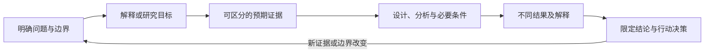

# Grill My Research｜课题拷问与科研逻辑闭环

[English](README.en.md) · [Skill 指令](SKILL.md) · [设计思路](docs/DESIGN.md) · [使用示例](examples/interactive-example.md) · [贡献指南](CONTRIBUTING.md)

用有承接关系的追问和有证据权重的反馈，帮助你把一个想法整理成明确的研究问题、
可区分的解释、可执行的判别计划，以及会随结果改变的研究决策。

你可以从一句不成熟的想法开始。它每轮抓住最影响判断的一个缺口，依据你的真实回答
继续追问；最后交付一份可以用来组织开题、组会或下一步工作的课题论证简报。

## 核心设计

- **连环提问有依赖**：上一答改变下一问，每轮默认只有一个主要问题。
- **反馈有辩证性**：保留主张最有力的部分，检验最相关的竞争解释，再根据证据作出有边界的判断。
- **不强行平衡**：证据不对称时可以明确倾向一边；反对意见同样需要理由。
- **未知不伪装成事实**：区分用户报告、已核对材料／文献、工作假设、AI 推断与未知。
- **结果必须改变决策**：提前讨论什么会支持、削弱或无法判别假设，以及何时补证、收窄或转向。
- **逻辑组织是交付的一部分**：把技术清单重组为问题、解释、证据与决策之间的关系。

“拷问”的对象是论证，不是研究者。它应当既能指出漏洞，也能认可已经得到充分支持
的部分。这个 skill 为常见的迎合、泛泛质疑和跳跃式问答设置了具体行为规则，但不
保证任何模型都会完美执行，也不把对话自洽当作科学正确。

## 什么叫科研闭环



**设计闭合与证据成立分开记录。** 一个方案可能逻辑齐全但关键数据还拿不到；一个
结果可能支持局部结论但不能证明完整机制。最终状态会明确区分：

| 状态 | 含义 |
|---|---|
| `OPEN` | 关键前提或连接仍缺失 |
| `DESIGN_READY` | 问题、判别设计、分析、结果决策和必要条件已对应，尚非研究结果被证实 |
| `INCONCLUSIVE` | 已有结果但证据不足以区分主要解释 |
| `SUPPORTED_WITHIN_SCOPE` | 现有证据支持限定结论，并记录来源与边界 |
| `REFRAME` | 当前问题或路径需收窄／重构，由用户决定采用哪条新路径 |

这是一套工作状态，不是科研质量评分表。详见 [设计思路](docs/DESIGN.md)。

## 安装

核心 skill 是指令和参考文件，**无需 Python、API Key 或额外插件**。在支持本地
skill 的 Codex 中，从 GitHub 仓库首页选择 **Code → Download ZIP**。解压后将包含
`SKILL.md` 的文件夹重命名为 `grill-my-research-skill`，放到
用户级 skill 目录，使 `SKILL.md` 直接位于该文件夹第一层。
目录说明依据 [OpenAI 官方 skill 文档](https://learn.chatgpt.com/docs/build-skills)。

Windows：`%USERPROFILE%\.agents\skills\grill-my-research-skill\SKILL.md`

macOS/Linux：`~/.agents/skills/grill-my-research-skill/SKILL.md`

已有同名版本时先备份并核对，不要复制成多层嵌套或期待两份指令自动合并。
若安装后未显示，重新打开会话或重启宿主后检查。

本仓库不会自动修改你已有的 skill 安装。Python 3.11+ 与
[requirements-dev.txt](requirements-dev.txt) 仅用于维护者校验与打包，不是对话运行依赖。

## 开始使用

### 交互拷问

```text
使用 $grill-my-research-skill 拷问我的课题。
每次只抓一个最关键问题，等我回答后再追问；既不要迎合，也不要为反对而反对。
六轮内给我一次阶段总结，最后整理研究问题、核心解释、判别设计、结果分支和下一步。
我的初步想法是：……
```

没有成熟方案也可以开始，不需要先写完一份长问卷。若你已经提供详细材料，它应直接
寻找最弱连接，不让你重复背景。

### 一次性诊断

```text
使用 $grill-my-research-skill 完整诊断下面的研究方案，不先做互动问答。
区分事实、假设和推断；提出最有力的竞争解释，检查每个结果会怎样改变结论和行动。
把材料缺口写成待确认项，给出当前能支持的结论与课题逻辑叙事。
方案：……
```

### 答辩模拟

```text
使用 $grill-my-research-skill 模拟开题评审，连环追问并提供示范回答。
示范内容必须标为模拟，新引入的前提标为假设，不能写成我已经做过的实验或已有数据。
我的课题信息：……
```

默认采用交互模式；只有你要求模拟时才自行生成“回答”。随时说“先总结”即可得到
阶段结果，不必答满预定轮数。参见 [真实交互式示例的格式](examples/interactive-example.md)
和 [辩证反馈示例](examples/dialectical-example.md)，其中内容均明确标为虚构示例。

## 最终得到什么

默认在聊天里得到一份紧凑的课题论证简报：

1. 收窄后的研究问题、适用范围与相对初始想法的改动。
2. 当前状态、限定判断、证据来源与最弱连接。
3. 核心解释、最相关的竞争解释、已知与待补证内容。
4. 最小判别行动和它解决的具体缺口。
5. 不同结果对应的解释、结论边界与行动决策。
6. 优先下一步、停止／转向条件，以及一段可用于汇报的课题逻辑叙事。

需要文件时可使用 [简报模板](assets/research-brief.md)、
[结果—决策矩阵](assets/decision-matrix.md) 和 [续接快照](assets/session-state.yaml)。
快照只有真实保存后才可复用；不声称跨聊天自动记忆。

## 适用范围与边界

支持实验、观察、计算、理论、质性、探索、方法与复现等研究类型，按相应证据标准
调整问题，不把所有课题都改造成因果机制实验。理论研究不被强制要求样本量，质性
研究不被机械要求 p 值，技术名称也不能代替研究问题。

它可以审查已有材料的逻辑，不能在未检索时确认“全球首次”，也不会凭空生成文献、
样本量、预算或成功率。材料不足时照样给阶段结果，保留影响决策的未知。
少量方法依据和适用边界见 [方法背景](references/methodological-notes.md)。

课题材料是否可被云端模型访问，由你使用的宿主产品决定。本仓库不包含任何自动上传
研究材料的工具；不要将未公开数据随仓库或 Issue 一起发布。

## 仓库结构

```text
grill-my-research-skill/
├── SKILL.md                 # Agent 入口与核心行为
├── agents/openai.yaml       # Codex 显示信息
├── references/              # 提问路由、辩证反馈、闭环与续接规则
├── assets/                  # 可复用简报、决策矩阵、会话快照
├── examples/                # 明确标记的虚构对话示例
├── evals/                   # 14 个行为场景及人工评估标准
├── scripts/                 # 仓库校验和干净源码打包
├── tests/                   # 校验／打包工具的单元测试
├── docs/                    # 设计、验证范围与 GitHub 上传说明
└── .github/                 # 自动检查、Issue 和 PR 模板
```

## 维护与校验

维护者运行：

```text
python -m pip install -r requirements-dev.txt
python scripts/validate_repository.py
python -m unittest discover -s tests -v
python scripts/package_skill.py --output dist/grill-my-research-skill.zip
```

脚本校验元数据、链接、文件范围和打包行为，**不测量 AI 的科学判断质量**。
[14 个行为场景](evals/README.md) 可用于目标模型的真实交互评估；它们目前是评估设计，
不是已经通过的模型测试。验证记录的准确范围见 [docs/VALIDATION.md](docs/VALIDATION.md)。

在 GitHub 的 **Actions** 标签页查看各次提交的自动检查结果。发布副本时，参见
[GitHub 发布指南](docs/GITHUB_UPLOAD.md)。

## 许可证与贡献

本仓库自身的代码、模板和说明采用 [MIT License](LICENSE)。外部来源保留其各自权利。
改进请参见 [CONTRIBUTING.md](CONTRIBUTING.md) 与 [CHANGELOG.md](CHANGELOG.md)。
